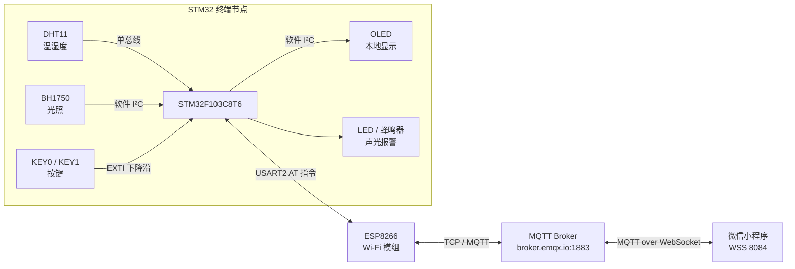

# 智能家居系统（Smart Home）

基于 **STM32F103C8T6 + ESP8266 + MQTT** 的物联网智能家居系统，包含 **硬件终端固件**、**微信小程序控制端** 和 **PCB 原理图** 三部分，可实现温湿度/光照采集、OLED 本地显示、超限声光报警、以及手机端远程监测与远程控制。

<p align="left">
  
  
  
  
  
  
</p>

---

## 目录

- [功能特性](#功能特性)
- [系统架构](#系统架构)
- [网络通信协议](#网络通信协议)
- [硬件设计](#硬件设计)
- [软件设计](#软件设计)
- [快速开始](#快速开始)
- [目录结构](#目录结构)
- [使用说明](#使用说明)
- [已知问题与待改进](#已知问题与待改进)
- [致谢](#致谢)

---

## 功能特性

| 分类 | 功能 | 说明 |
| --- | --- | --- |
| 数据采集 | 温湿度采集 | DHT11 单总线传感器，读取温度（℃）与湿度（%） |
| 数据采集 | 光照强度采集 | BH1750 数字光照传感器，经软件 I²C 读取照度（lx） |
| 本地显示 | OLED 实时显示 | 0.96" OLED（SSD1306）显示温湿度、光照与配网状态 |
| 本地交互 | 按键控制 | KEY0 手动开关客厅灯，KEY1 手动开关报警器 |
| 报警 | 超限声光报警 | 温度 / 湿度 / 光照越限时 LED 闪烁 + 蜂鸣器鸣叫 |
| 远程监测 | 手机端实时数据 | 微信小程序订阅 MQTT 主题，实时刷新温度、湿度、光照 |
| 远程控制 | 手机端远程开关 | 小程序下发 JSON 指令控制客厅灯与报警器 |
| 组网 | Wi-Fi 联网 | ESP8266 AT 固件联网，通过 MQTT 与服务端双向通信 |

---

## 系统架构



数据流向：

1. 终端节点每 400 ms 采样一次 DHT11 与 BH1750，并做阈值判断；
2. 每约 2 s 将打包好的 JSON 通过 MQTT 发布到上行主题；
3. 小程序订阅上行主题刷新界面，用户操作开关时向下行主题发布控制指令；
4. 终端节点收到指令后用 `cJSON` 解析并驱动 LED / 蜂鸣器，同时回传最新状态。

---

## 网络通信协议

### 主题（Topic）

| 方向 | Topic | 负载示例 |
| --- | --- | --- |
| 设备 → App（上行） | `/mysmarthomeriverchen/pub` | `{"Temp":26,"Hum":58,"Light":235.5,"Led":1,"Beep":0}` |
| App → 设备（下行） | `/mysmarthomeriverchen/sub` | `{"target":"LED","value":1}` 或 `{"target":"BEEP","value":0}` |

字段说明：

| 字段 | 含义 | 取值 |
| --- | --- | --- |
| `Temp` | 温度 | 整数，单位 ℃ |
| `Hum` | 湿度 | 整数，单位 %RH |
| `Light` | 光照强度 | 浮点，单位 lx |
| `Led` | 客厅灯状态 | `1` 亮 / `0` 灭 |
| `Beep` | 报警器状态 | `1` 报警 / `0` 正常 |
| `target` | 控制目标 | `LED` / `BEEP`（固件以 `LED` 关键字区分，其余按报警器处理） |
| `value` | 控制值 | `1` 开 / `0` 关 |

### 连接参数

| 参数 | 终端节点（STM32） | 小程序 |
| --- | --- | --- |
| Broker | `broker.emqx.io` | `broker.emqx.io` |
| 端口 | `1883`（TCP，AT+CIPSTART） | `8084`（WSS，`wxs://`） |
| QoS | 0 | 0 |
| ClientID | OneNET 风格设备名 | 由 mqtt.js 自动生成 |

> 固件中保留了 OneNET 平台接入能力（`OneNet_Authorization` 基于 HMAC-SHA1 + Base64 生成 Token，见 `NET/onenet`），当前默认连接公共 EMQX Broker，便于与小程序直连调试。

---

## 硬件设计

### 主控与关键器件

| 器件 | 型号 | 说明 |
| --- | --- | --- |
| 主控 MCU | STM32F103C8T6 | Cortex-M3，64 KB Flash / 20 KB SRAM |
| 温湿度传感器 | DHT11 | 单总线，±2 ℃ / ±5 %RH |
| 光照传感器 | BH1750FVI | I²C，1–65535 lx |
| 显示屏 | 0.96" OLED（SSD1306） | 128×64，软件 I²C |
| Wi-Fi 模组 | ESP8266（AT 固件） | 串口 AT 指令，STA 模式 |
| 提示器件 | 有源蜂鸣器 + LED ×2 | 声光报警 / 状态指示 |

### 引脚分配

| 功能 | 引脚 | 备注 |
| --- | --- | --- |
| 调试串口 USART1 | PA9 (TX) / PA10 (RX) | 115200 bps，`ESP8266` 通信日志 |
| ESP8266 串口 USART2 | PA2 (TX) / PA3 (RX) | 115200 bps |
| ESP8266 复位 | PA0 | 初始化时低电平复位 |
| DHT11 数据线 | PA8 | 单总线 |
| BH1750 I²C | PB6 (SCL) / PB7 (SDA) | 软件 I²C，地址 `0x23` |
| OLED I²C | PA5 (SCL) / PA7 (SDA) | 软件 I²C |
| 客厅灯 LED0 | PA4 | 低电平点亮 |
| 报警灯 LED1 | PC13 | 定时器中断中翻转 |
| 蜂鸣器 | PA0 | 高电平关闭，低电平鸣叫 |
| 按键 KEY0 | PB0 | EXTI0 下降沿，切换 LED0 |
| 按键 KEY1 | PB1 | EXTI1 下降沿，切换报警状态 |

> ⚠️ 注意：当前代码中蜂鸣器（`Buzzer.c`）与 ESP8266 复位脚都定义了 `PA0`，实际打板/接线时请将 ESP8266 复位改到其它空闲 IO，或删除 `ESP8266_Init()` 中的复位时序。

### PCB 工程

`smart home pcb/` 为 Altium Designer 工程（`smart-home pcb.PrjPcb` + `智能家居.SchDoc`），使用 Altium Designer 直接打开工程即可查看/编辑原理图与生成 PCB。

---

## 软件设计

### 终端固件（`源代码/`）

- **开发环境**：Keil MDK 5（工程文件 `stm32f103.uvprojx`，Target `STM32F103C8`）
- **底层库**：STM32F10x 标准外设库（`fwlib/`）+ CMSIS（`core/`）
- **预定义宏**：`STM32F10X_MD, USE_STDPERIPH_DRIVER`
- **联网与协议**：`NET/MQTT`（MqttKit 协议打包/解包）、`NET/device`（ESP8266 AT 驱动）、`NET/onenet`（OneNET Token 生成）、`NET/cjson`（JSON 解析）

核心流程（`user/main.c`）：

```
外设初始化（LED/KEY/EXTI/蜂鸣器/BH1750/USART/OLED）
        ↓
DHT11 初始化（失败重试）
        ↓
ESP8266 复位 → AT → CWMODE=1 → CWDHCP → CWJAP 连接热点
        ↓
TCP 连接 MQTT Broker → MQTT CONNECT → 订阅下行主题
        ↓
主循环：
  ├─ 每 400 ms 采样温湿度/光照，超限置 alarmFlag
  ├─ 每 ~2 s 打包 JSON 并 Publish 上行主题
  └─ 轮询 ESP8266 数据，收到 Publish 报文则解析指令并执行
```

报警逻辑：

- 判定条件：`humidity ≥ 80%` 或 `temperature ≥ 30℃` 或 `Light ≥ 10000 lx`；
- 触发后 `TIM3` 中断内翻转 LED1 并驱动蜂鸣器；
- 报警状态被按键/远程指令手动切换后，`alarm_is_free` 计数 10 个周期（约 4 s）内不再被自动判定覆盖，避免状态抖动。

本地显示（`TIM2` 中断，约 500 ms 刷新一次）：

```
        Welcome
   humidity:58 %
  temperature:26 C
     Light:235.5 Lx
```

### 微信小程序（`smarthome_riverchen_mp/`）

- 框架：微信小程序原生开发（`glass-easel`），基础库 `trial`
- MQTT 客户端：`utils/mqtt.js`（mqtt.js 浏览器打包版，通过 `wx.connectSocket` 走 WebSocket）
- 页面：`pages/index`（首页仪表盘）、`pages/logs`（本地操作日志，底部 TabBar 切换）
- 首页组件：温度、湿度、光照三张数据卡片 + 客厅灯、报警器两个 `switch` 开关
- 关键逻辑（`pages/index/index.js`）：
  - `onShow` 中建立连接 → 订阅设备上行主题 → `message` 回调中 `JSON.parse` 并 `setData` 刷新；
  - `onLedChange` / `onBeepChange` 中向下行主题发布 `{"target":...,"value":...}`。

---

## 快速开始

### 1. 克隆仓库

```bash
git clone https://github.com/riverchener/smart-home.git
cd smart-home
```

### 2. 编译并烧录固件

1. 用 Keil MDK 打开 `源代码/stm32f103.uvprojx`；
2. 修改 Wi-Fi 名称与密码：`源代码/NET/device/src/esp8266.c`

   ```c
   #define ESP8266_WIFI_INFO  "AT+CWJAP=\"你的WiFi名称\",\"你的WiFi密码\"\r\n"
   ```

3. 如需自建 Broker，修改 `源代码/user/main.c`

   ```c
   #define ESP8266_ONENET_INFO  "AT+CIPSTART=\"TCP\",\"broker.emqx.io\",1883\r\n"
   ```

4. 修改自定义主题（可选）：`user/main.c` 中的 `devSubTopic` / `devPubTopic`；
5. `Build` 编译后通过 ST-Link / DAP-Link 烧录，或使用 `源代码/output/stm32f103.hex`。

### 3. 运行微信小程序

1. 用 **微信开发者工具** 导入 `smarthome_riverchen_mp/` 目录；
2. 将 `project.config.json` 中的 `appid` 替换为你自己的小程序 AppID；
3. 若使用自建 Broker，修改 `pages/index/index.js` 中的连接参数与主题：

   ```js
   const mqttHost = 'broker.emqx.io'
   const mqttPort = 8084
   const deviceSubTopic = '/mysmarthomeriverchen/sub'
   const devicePubTopic = '/mysmarthomeriverchen/pub'
   ```

4. 在开发者工具中勾选「不校验合法域名」（本地调试），正式发布需在小程序后台配置 socket 合法域名；
5. 点击编译预览，手机扫码即可远程查看与控制。

> 💡 公共 Broker `broker.emqx.io` 为开放测试服务，任何人可收发同主题消息。生产环境请自建 Broker（EMQX / Mosquitto）并启用鉴权，同时把主题改为设备唯一 ID。

---

## 目录结构

```
smart-home/
├── 源代码/                        # STM32 终端固件（Keil MDK 工程）
│   ├── stm32f103.uvprojx          # Keil 工程文件
│   ├── user/main.c                # 主流程：采集 / 上传 / 指令处理
│   ├── core/                      # CMSIS 内核与启动文件、中断向量
│   ├── fwlib/                     # STM32F10x 标准外设库
│   ├── hardware/                  # 板级驱动
│   │   ├── DHT11/                 # 温湿度传感器
│   │   ├── BH1750/                # 光照传感器（软件 I²C）
│   │   ├── OLED/                  # 0.96" OLED 显示与字库
│   │   ├── KEY/  LED/  buzzer/    # 按键、LED、蜂鸣器
│   │   ├── EXTI/                  # 外部中断（按键）
│   │   ├── TIMER/                 # TIM2 刷新显示 / TIM3 报警闪烁
│   │   └── inc/  src/             # delay / sys / usart 底层驱动
│   ├── NET/                       # 网络与协议栈
│   │   ├── MQTT/                  # MQTT 报文打包与解析（MqttKit）
│   │   ├── device/                # ESP8266 AT 指令驱动
│   │   ├── onenet/                # OneNET Token（HMAC-SHA1 + Base64）
│   │   └── cjson/                 # 轻量 JSON 解析
│   └── output/                    # 编译产物（hex / axf / map）
├── smarthome_riverchen_mp/        # 微信小程序控制端
│   ├── app.js / app.json / app.wxss
│   ├── pages/index/               # 首页：数据卡片 + 控制开关
│   ├── pages/logs/                # 操作日志页
│   ├── utils/mqtt.js              # MQTT 客户端（WebSocket）
│   └── static/                    # 图标资源
└── smart home pcb/                # Altium Designer 原理图工程
    ├── smart-home pcb.PrjPcb
    └── 智能家居.SchDoc
```

---

## 使用说明

| 操作 | 效果 |
| --- | --- |
| 上电 | OLED 显示 `Networking`，联网成功后显示 `Connected to ONENET`，蜂鸣器短鸣一声 |
| 短按 KEY0 | 手动开/关客厅灯（同步到手机端） |
| 短按 KEY1 | 手动开/关报警器（同步到手机端） |
| 环境超限 | 温度 ≥ 30 ℃、湿度 ≥ 80 % 或光照 ≥ 10000 lx 时自动声光报警 |
| 小程序「客厅灯」开关 | 下发 `{"target":"LED","value":1}` 远程点灯 |
| 小程序「报警器」开关 | 下发 `{"target":"BEEP","value":1}` 远程启动报警 |

---

## 已知问题与待改进

- [ ] **PA0 引脚复用冲突**：蜂鸣器与 ESP8266 复位脚同为 `PA0`，建议迁移复位脚或改用软复位；
- [ ] **小程序 `onBeepChange` 误用 `setData({Led: sw})`**，应改为 `setData({Beep: sw})`，否则报警器开关状态显示不同步；
- [ ] 首页光照单位显示为 `rx`，应为 `lx`；顶部天气/空气质量为静态占位，可接入天气 API；
- [ ] 公共 Broker 无鉴权、主题固定，建议改为「一机一密 + 设备独立主题」，并增加 TLS 加密；
- [ ] Wi-Fi 账号密码硬编码在源码中，建议改为串口配置或存储到 Flash 参数区；
- [ ] 增加断线重连、心跳保活与数据本地缓存（掉线期间数据补传）；
- [ ] 增加历史数据存储与曲线图、场景联动（如光照不足自动开灯）。

---

## 致谢

- 底层驱动与外设模板参考 **正点原子（ALIENTEK）** STM32F103 例程；
- DHT11 / BH1750 / OLED 驱动参考 **江协科技（江科大）** 系列教程；
- MQTT 协议层使用 **OneNET MqttKit** 与 **cJSON**；
- 公共 MQTT 测试服务由 **EMQX** 提供。

本项目仅用于学习与技术交流，欢迎提 Issue 或 PR 一起完善 🙂
